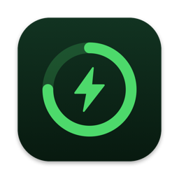

<p align="center">
  
</p>

<h1 align="center">Batteries</h1>

<p align="center">
  <strong>Battery levels of the Mac, its accessories and the iPhone, with per-battery alerts</strong>
</p>

<p align="center">
  <a href="https://github.com/Erel3/batteries/releases/latest"></a>
  
  <a href="LICENSE"></a>
</p>

---

A personal replacement for AirBuddy's battery features. No menu bar icon, no self-updating,
nothing runs unless the owner starts it.

- **Every battery**: the Mac, Bluetooth accessories (AirPods per bud and case, keyboards, mice)
  and a trusted iPhone over cable or Wi-Fi, read through Finder's existing pairing.
- **Alerts per battery**: low while discharging, charged while charging, each with its own level,
  shown as a notification or a ring in the centre of the screen.
- **Widget** in the layout of macOS's own Batteries widget. Devices out of reach stay greyed with
  their last value.

## Build

Requires Xcode (Swift 6) and [just](https://github.com/casey/just).

```sh
just test      # unit and render tests
just app       # signed dist/Batteries.app with the widget inside
just install   # replace /Applications/Batteries.app
```

Signing uses a Developer ID; set `CODESIGN_ID` to your own identity.
